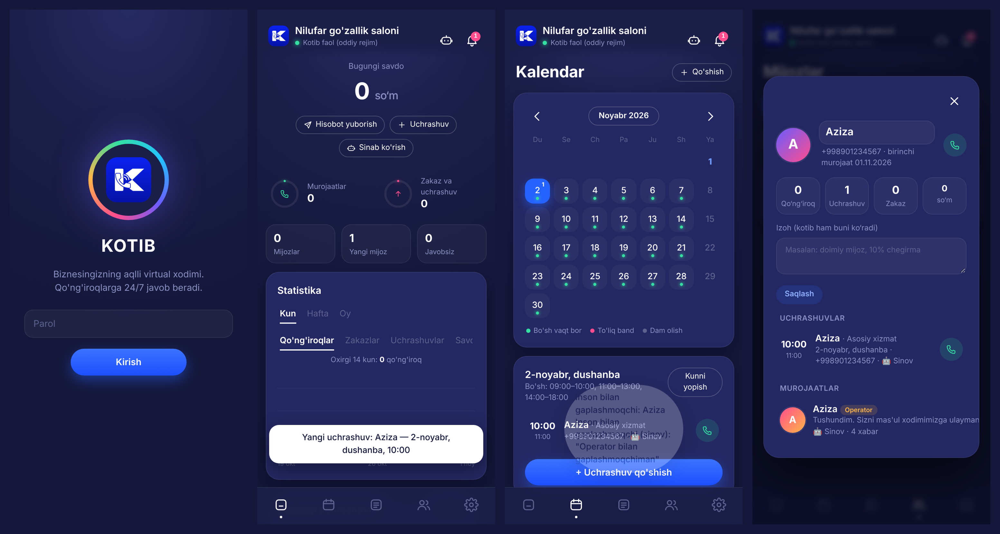

# Kotib — biznes uchun aqlli virtual kotib



Biznes egasining 24/7 ishlaydigan virtual xodimi. Telefon raqamga ulanadi, qo'ng'iroqlarga o'zbek va rus tillarida javob beradi, savollarga javob beradi, bo'sh vaqtlarni aytadi, uchrashuv va zakaz qabul qiladi va hammasini ilovadagi kalendarga yozadi.

## Imkoniyatlar

| | |
|---|---|
| 📞 **24/7 qo'ng'iroqlar** | Twilio orqali raqamga keladigan qo'ng'iroqlarga javob beradi. Boshida til tanlanadi: o'zbekcha (gapirish yoki 1), ruscha (2). Tanish mijoz o'z tilida va ismi bilan kutib olinadi. |
| 💬 **Tabiiy suhbat** | AI (Gemini / Groq / OpenAI-mos) bilan jonli xodimdek gaplashadi. AI kaliti bo'lmasa — oddiy qoidalar asosida ishlaydi. SMS, WhatsApp va saytdagi chat ham bor (`/chat`). |
| 🗓 **Uchrashuvlar** | Ish vaqti, tanaffus, dam olish kunlari va band vaqtlarni hisobga olib bo'sh vaqtni aytadi ("ertaga 09:00–13:00, 14:00–18:00"), yozib qo'yadi va kalendarga saqlaydi. |
| 🛒 **Zakazlar** | Mahsulotlar bazasidan narx va qoldiqni aniq aytadi, zakaz oladi, qoldiqni avtomatik kamaytiradi (bekor qilinsa qaytaradi). |
| 🙋 **Insonga topshirish** | Mijoz operator so'rasa yoki masala nozik bo'lsa (shikoyat, pul qaytarish, chegirma...) — qo'ng'iroqni operator raqamiga ulaydi. Operator javob bermasa — "qayta qo'ng'iroq" vazifasi yaratadi. |
| 👥 **Mijozlarni eslab qolish** | Har bir raqam bo'yicha: ismi, tili, qo'ng'iroqlar, uchrashuvlar, zakazlar, oldingi murojaatlar va egasining izohi. AI bularni ko'rib gaplashadi. |
| 📵 **O'tkazib yuborilgan qo'ng'iroqlar** | Javobsiz yoki gapirmasdan tugagan qo'ng'iroqlar, javob topilmagan savollar uchun vazifa yaratadi. |
| ⏰ **Eslatmalar** | Uchrashuvdan oldin mijozga SMS eslatma (standart: 24 va 2 soat oldin). |
| ✈️ **Telegram** | Yangi uchrashuv, zakaz, javobsiz qo'ng'iroq va **kunlik hisobot** (qo'ng'iroqlar, mijozlar, zakazlar, savdo) egasiga Telegramga keladi. |
| 📱 **Ilova** | Telefonga o'rnatiladigan PWA: bosh sahifa (savdo, statistika, grafik), kalendar, buyurtmalar, mijozlar, vazifalar, kotibni sinash, sozlamalar. |

## Ishga tushirish

```bash
cd kotib
npm install
npm start
```

Brauzerda `http://localhost:3100` ni oching → biznes nomi va parol kiriting → **Sozlamalar**'da ish vaqti, xizmatlar, mahsulotlar va savol-javoblarni to'ldiring → **🤖 Sinov**'da kotibni sinab ko'ring.

Tekshiruv: `npm test` (umumiy) va `node test-voice.js` (o'zbekcha ovoz)

## Serverga joylash (Render)

1. Render → **New Web Service** → shu repo, **Root Directory**: `kotib`, Build: `npm install`, Start: `npm start` (yoki `kotib/Dockerfile`).
2. Environment'ga kamida `PUBLIC_URL`, `DATABASE_URL` (bepul serverda fayl o'chib ketadi), `GEMINI_API_KEY` qo'shing. Hamma sozlamalar: [`env.example`](env.example).

## Telefon raqamni ulash (Twilio)

1. [Twilio](https://www.twilio.com)'da raqam oling, `TWILIO_ACCOUNT_SID`, `TWILIO_AUTH_TOKEN`, `TWILIO_FROM` ni serverga qo'shing.
2. Raqam sozlamalari:
   - **A call comes in** → `POST https://SAYTINGIZ/twilio/voice`
   - **Call status changes** → `POST https://SAYTINGIZ/twilio/status`
   - **A message comes in** → `POST https://SAYTINGIZ/twilio/sms`
3. O'z raqamingizdan Twilio raqamiga qo'ng'iroqni yo'naltiring: hammasi — `**21*raqam#`, javob bermasangiz — `**61*raqam#`, band bo'lsangiz — `**67*raqam#`.

## Sof o'zbekcha ovoz

Twilio'ning o'zida o'zbekcha ovoz yo'q, shuning uchun ilovadagi **Sozlamalar → Ulanishlar**ga o'zbekcha ovoz xizmati kalitini kiriting:

- **Aisha** ([space.aisha.group](https://space.aisha.group)) — tavsiya etiladi: o'zbekcha ovoz (TTS) va nutqni tanish (STT). **O'z ovozingiz:** Aisha'da ovozingizni klonlab, `voice_id`ni "Aisha: o'z ovozingiz ID"ga kiritsangiz, kotib hamma javoblarni sizning ovozingizda aytadi.
- **Muxlisa** (muxlisa.uz) yoki **Microsoft Azure** (`uz-UZ-MadinaNeural`) — zaxira.

Kotib vaqt, sana, narx va raqamlarni o'zbekcha so'z bilan o'qiydi ("14:30" → "o'n to'rt o'ttiz", "250 000 so'm" → "ikki yuz ellik ming so'm"), AI'ga esa sof o'zbek tili qoidalari berilgan (ruscha so'zlarsiz). Kalit kiritilgach "▶ Ovozni eshitish" tugmasi bilan sinab ko'ring.

**Salomlashish o'z ovozingizda:** Sozlamalar → Ovoz → "🎙 Yozib olish" yoki "📁 Fayl tanlash" (har qanday audio: telefon ovozli xabari, m4a, ogg, mp3). Qo'ng'iroq boshida shu yozuv eshittiriladi.

Kalit bo'lmasa kotib baribir ishlaydi: o'zbekcha javoblarni Twilio'ning turkcha ovozi o'qiydi, ruscha ovoz esa tabiiy eshitiladi.

## Telegram

@BotFather'da bot yarating → tokenni `TG_BOT_TOKEN` qilib qo'shing → botga `/start` yozing → chat ID'ni (@userinfobot aytadi) panelda kiriting → **Sinov xabari**. Kunlik hisobot vaqti — Sozlamalar → Kotib.

## Tuzilishi

- `server.js` — API, kirish, Twilio (qo'ng'iroq, holat, operator, SMS)
- `core.js` — mijozlar, uchrashuv, zakaz, vazifalar, Telegram/SMS, eslatmalar, hisobot
- `assistant.js` — AI va qoidalar asosidagi suhbat (o'zbek/rus)
- `voice.js` — o'zbekcha ovoz (Aisha / Muxlisa / Azure), nutqni tanish, raqamlarni so'z bilan o'qish
- `config.js` — ulanishlar (API kalitlari)
- `slots.js` — bo'sh vaqtlarni hisoblash
- `store.js` — saqlash (PostgreSQL yoki JSON fayl)
- `public/` — ilova (panel), mijoz chati, logotip
